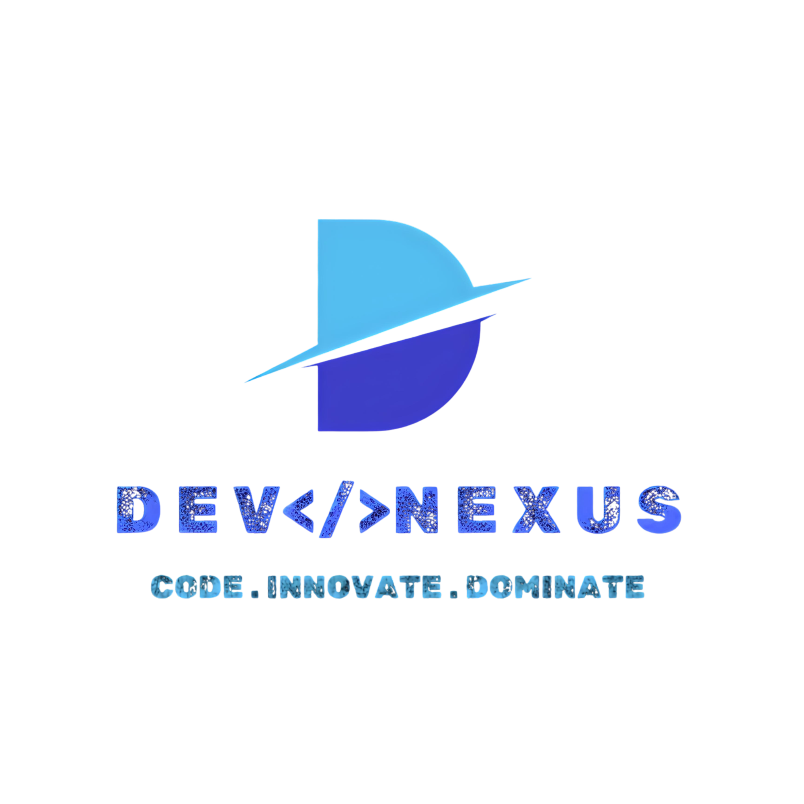

# DevNexus 2.0 • Badge Forge

An 8-bit retro arcade-style participant badge generator built for **DevNexus 2.0 | The Castle Hackathon**.



## Features
- **Official Roster Integration**: Automatically syncs teams and members from the official hackathon Google Sheet.
- **Strict Participant Validation**: Participant names and team names are strictly locked to the official spreadsheet data (preventing typos and unauthorized names).
- **Interactive Photo Positioning**: Drag & drop participant photo into the badge's custom arched citadel crest. Includes real-time pan (drag on canvas or sliders), zoom, and rotation controls.
- **Pixel Art Citadel Theme**: 8-bit retro gaming typography (`Press Start 2P`, `Silkscreen`, `VT323`), chunky arcade borders, scanlines overlay, and glowing cybernetic accents.
- **Dual Export Resolution**:
  - **Standard HD (1512 × 2268)**: Fast, lightweight download for web and mobile.
  - **Ultra-HD Master (7559 × 11339)**: 300 DPI master print quality.
- **Zero-CORS & Offline Ready**: All frame assets are embedded so `index.html` can be double-clicked and run offline in any browser with zero setup.

## Quick Start
1. Double-click `index.html` to open directly in your web browser.
2. Or run the local server script:
   ```bash
   chmod +x start.sh
   ./start.sh
   ```
   and navigate to `http://localhost:8080`.

